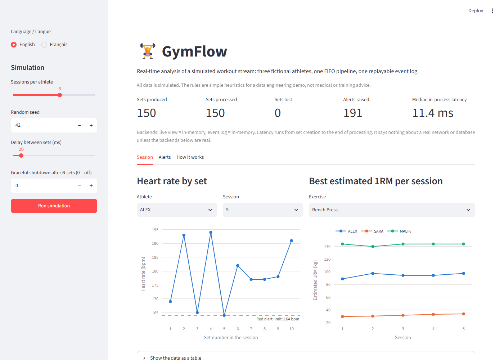

# GymFlow : analyse en temps réel d'un flux de séances

[English](README.md) · **App en ligne :** _lien ajouté après le déploiement_

GymFlow traite un flux de séries de musculation au moment où elles arrivent. Trois athlètes simulés envoient leurs séries en parallèle, un pipeline FIFO analyse chacune d'elles selon des règles d'entraînement, et chaque série est enregistrée dans un journal d'événements rejouable.



## Problème

L'analyse de l'entraînement se fait le plus souvent après la séance, quand le moment utile est passé. GymFlow explore la partie data engineering d'une analyse faite pendant la séance :
- fusionner plusieurs flux simultanés sans perdre de données ;
- s'arrêter proprement alors que des séries sont encore en cours de traitement ;
- tenir à la fois une vue en direct et un historique complet, dans deux bases différentes.

## Données

**Toutes les données sont synthétiques.** ALEX, SARA et MALIK sont des profils fictifs avec trois tendances intégrées : surmenage, progression et plateau. Chaque tirage aléatoire vient d'un générateur à graine propre à chaque athlète et à chaque séance : un lancement est donc reproductible, quel que soit l'ordre d'exécution des tâches.

Les règles sont de simples heuristiques d'entraînement. C'est une démo de data engineering, pas un conseil médical ou sportif.

## Méthode

```
flux ALEX  ─┐
flux SARA  ─┼─▶ file FIFO ─▶ moteur d'analyse ─┬─▶ vue en direct (Redis, ou en mémoire)
flux MALIK ─┘                                  └─▶ journal d'événements (MongoDB, ou mongomock)
```

| Patron | Mise en œuvre |
|---|---|
| Fan-in | Un producteur `asyncio` par athlète alimente une seule file FIFO. |
| Arrêt propre | Un signal utilisable depuis n'importe quel thread arrête les producteurs. Chacun envoie toujours un marqueur de fin de flux, et le consommateur vide la file avant de s'arrêter. |
| Verrou | Les modifications de programme par les coachs sont des opérations lecture-modification-écriture, sérialisées par un `asyncio.Lock` par athlète. |
| Event sourcing | Chaque série est un événement ajouté sans modification. Les totaux d'un athlète se recalculent en rejouant le journal. |
| Persistance polyglotte | Base clé-valeur pour l'état courant, base documentaire pour l'historique. Les appels bloquants aux bases s'exécutent dans des threads séparés. |

**Règles :**
- **Rouge :** fréquence cardiaque au-dessus de 85 % de la FC max, ou RPE ≥ 9.
- **Orange :** repos court sous une charge lourde (plus de 70 % du 1RM estimé par la formule d'Epley pour l'exercice), ou répétitions manquées à RPE > 7.
- **Vert :** objectifs atteints à RPE ≤ 6.
- **Bleu (plateau) :** 1RM estimé en hausse de moins de 1 % sur les 3 dernières séances.

## Résultats

**Garanties du pipeline**, vérifiées par 25 tests automatiques :

| Vérification | Résultat |
|---|---|
| Séance complète | 30 séries produites, 30 traitées |
| Arrêt propre après 1, 5, 17 et 29 séries | Aucune série perdue, aucun blocage |
| 20 modifications simultanées de +1 kg | 20 kg appliqués avec le verrou, 1 kg sans (19 mises à jour perdues) |
| Relecture du journal | Mêmes totaux qu'un calcul direct |
| Même graine | Séries et alertes identiques |

**Comportement des règles sur les données simulées**, avec `python scripts/evaluate.py` (200 graines, 5 séances chacune, 30 000 séries, aucune perdue) :

| Athlète | Tendance intégrée | Alertes rouges par série | Orange par série | Vertes par série | Alertes plateau par vérification |
|---|---|---|---|---|---|
| ALEX | surmenage | 1,31 | 1,52 | 0,00 | 0,61 |
| SARA | progression | 0,00 | 0,03 | 0,41 | 0,10 |
| MALIK | plateau | 0,01 | 0,12 | 0,03 | 0,80 |

Les profils ont été écrits en pensant à ces règles : c'est une vérification de cohérence, pas une mesure de précision en conditions réelles.

Le tableau montre aussi une limite. SARA progresse par construction, mais 10 % de ses vérifications de plateau lèvent quand même une alerte : sa progression de 3 % par séance est proche du bruit d'une seule répétition. Une première version de la règle comparait la dernière séance à la meilleure des deux précédentes, et signalait SARA dans 36 % des vérifications. La comparaison avec le début de la fenêtre de 3 séances a ramené ce taux à 10 %.

## Technologies

Python · asyncio · pandas · Streamlit · Plotly · MongoDB (pymongo, mongomock) · Redis (Upstash) · pytest

## Lancer le projet

```bash
pip install -r requirements-dev.txt
pytest                                   # 25 tests
python run_session.py --sessions 3       # en ligne de commande
streamlit run app.py                     # app web
python scripts/evaluate.py --seeds 200   # tableau ci-dessus
```

Sans configuration, tout tourne en mémoire. Pour utiliser de vraies bases, copiez `.env.example` en `.env`, renseignez `MONGO_URI`, `REDIS_URL` et `REDIS_TOKEN`, puis chargez-les dans votre environnement. Ne commitez jamais `.env`.

## Organisation

```
app.py                app Streamlit (anglais et français)
run_session.py        lancement en ligne de commande
src/gymflow/
  profiles.py         athlètes et programmes fictifs
  simulator.py        générateur de séries à graine
  concurrency.py      fan-in, arrêt propre, verrou par athlète
  rules.py            règles d'alerte (fonctions pures)
  engine.py           consommateur, détection de plateau, relecture du journal
  storage.py          vue en direct et journal d'événements
  i18n.py             textes de l'interface et des alertes
scripts/evaluate.py   vérification sur plusieurs graines
tests/                tests pytest
```

## Limites et suites

- Les données sont simulées. La prochaine étape : un vrai export de montre ou d'application de salle, utilisé avec consentement.
- La latence est mesurée en interne uniquement. Elle ne dit rien d'un vrai réseau ou d'une vraie base.
- Les règles utilisent des seuils fixes. Des références propres à chaque athlète seraient plus réalistes.
- Pas d'authentification : c'est une démo, pas un produit.

## Auteur

Emmanuel Assahou, élève ingénieur à CY Tech (spécialité fintech). Projet réalisé d'abord pour un cours de Big Data, puis restructuré et testé pour ce portfolio.
