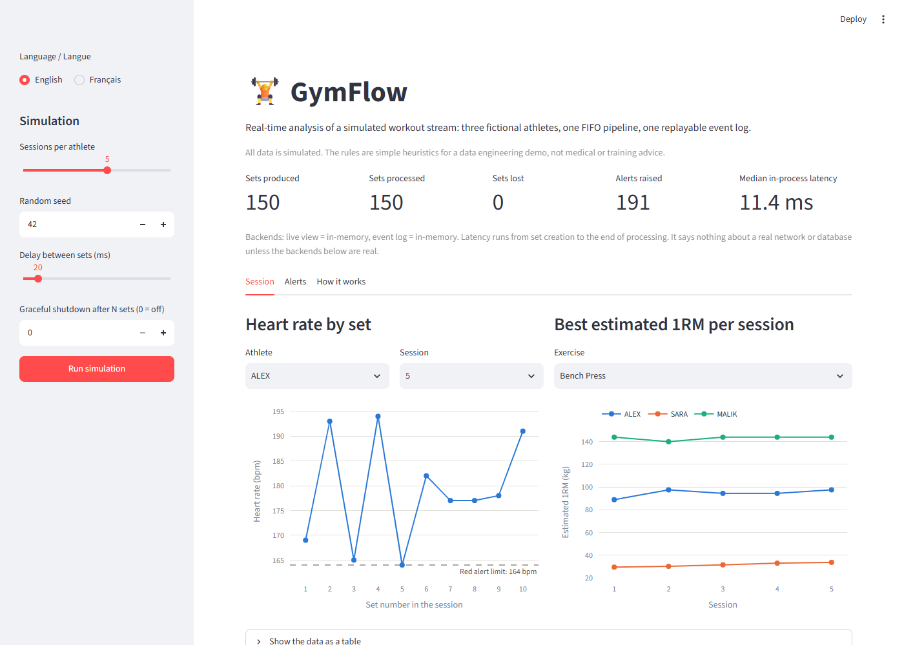

# GymFlow: real-time workout stream analysis

[Français](README.fr.md) · **Live app:** _link added after deployment_

GymFlow processes a stream of workout sets as they happen. Three simulated athletes send their sets concurrently, a FIFO pipeline analyses each one against training rules, and every set is stored in a replayable event log.



## Problem

Training analytics usually runs after the session, when the useful moment has passed. GymFlow explores the data engineering side of analysing sets as they arrive:
- merge several concurrent streams without losing any data;
- stop cleanly while sets are still in flight;
- keep a live view and a full history in two different stores.

## Data

**All data is synthetic.** ALEX, SARA and MALIK are fictional profiles with three built-in tendencies: overreaching, progressing and plateau. Every random draw comes from a seeded generator per athlete and session, so a run is reproducible whatever the task scheduling.

The rules are simple training heuristics. This is a data engineering demo, not medical or training advice.

## Method

```
ALEX  stream ─┐
SARA  stream ─┼─▶ FIFO queue ─▶ analysis engine ─┬─▶ live view (Redis, or in memory)
MALIK stream ─┘                                  └─▶ event log (MongoDB, or mongomock)
```

| Pattern | Implementation |
|---|---|
| Fan-in | One `asyncio` producer per athlete feeds a single FIFO queue. |
| Graceful shutdown | A thread-safe signal stops the producers. Each producer always sends an end-of-stream marker, and the consumer drains the queue before exiting. |
| Lock | Coach edits to a programme are read-modify-write operations, serialised by a per-athlete `asyncio.Lock`. |
| Event sourcing | Each set is an append-only event. Athlete totals can be rebuilt by replaying the log. |
| Polyglot persistence | Key-value store for the latest state, document store for the history. Blocking database calls run in worker threads. |

**Rules:**
- **Red:** heart rate above 85% of max HR, or RPE ≥ 9.
- **Orange:** short rest under a heavy load (above 70% of the Epley-estimated 1RM for that exercise), or missed reps at RPE > 7.
- **Green:** targets reached at RPE ≤ 6.
- **Blue (plateau):** estimated 1RM up by less than 1% over the last 3 sessions.

## Results

**Pipeline guarantees**, checked by 25 automated tests:

| Check | Result |
|---|---|
| Full session | 30 sets produced, 30 processed |
| Graceful shutdown after 1, 5, 17 and 29 sets | No set lost, no hang |
| 20 concurrent edits of +1 kg | 20 kg applied with the lock, 1 kg without (19 updates lost) |
| Replay of the event log | Same totals as a direct computation |
| Same seed | Identical sets and alerts |

**Rule behaviour on simulated data**, from `python scripts/evaluate.py` (200 seeds, 5 sessions each, 30,000 sets, 0 lost):

| Athlete | Built-in tendency | Red alerts per set | Orange per set | Green per set | Plateau alerts per check |
|---|---|---|---|---|---|
| ALEX | overreaching | 1.31 | 1.52 | 0.00 | 0.61 |
| SARA | progressing | 0.00 | 0.03 | 0.41 | 0.10 |
| MALIK | plateau | 0.01 | 0.12 | 0.03 | 0.80 |

The profiles were written with these rules in mind, so this is a sanity check, not a measure of real-world accuracy.

The table also shows a limit. SARA progresses by design, yet 10% of her plateau checks still raise an alert: the 3% weekly progression is close to the noise of one repetition. A first version of the rule compared the latest session with the best of the two before it, and flagged SARA in 36% of checks. Comparing with the start of the 3-session window brought that down to 10%.

## Stack

Python · asyncio · pandas · Streamlit · Plotly · MongoDB (pymongo, mongomock) · Redis (Upstash) · pytest

## Run it

```bash
pip install -r requirements-dev.txt
pytest                                   # 25 tests
python run_session.py --sessions 3       # command-line run
streamlit run app.py                     # web app
python scripts/evaluate.py --seeds 200   # table above
```

Without any configuration, everything runs in memory. To use real databases, copy `.env.example` to `.env`, fill in `MONGO_URI`, `REDIS_URL` and `REDIS_TOKEN`, and load them into your environment. Never commit `.env`.

## Project layout

```
app.py                Streamlit app (English and French)
run_session.py        command-line entry point
src/gymflow/
  profiles.py         fictional athletes and programmes
  simulator.py        seeded set generator
  concurrency.py      fan-in, graceful shutdown, per-athlete lock
  rules.py            alert rules (pure functions)
  engine.py           consumer, plateau check, event replay
  storage.py          live store and event log
  i18n.py             interface and alert text
scripts/evaluate.py   multi-seed sanity check
tests/                pytest suite
```

## Limits and next steps

- The data is simulated. The next step is a real export from a watch or a gym app, used with consent.
- Latency is measured in-process only. It says nothing about a real network or database.
- The rules use fixed thresholds. Per-athlete baselines would be more realistic.
- No authentication: this is a demo, not a product.

## Author

Emmanuel Assahou, CY Tech engineering student (fintech track). First built for a Big Data course, then restructured and tested for this portfolio.
